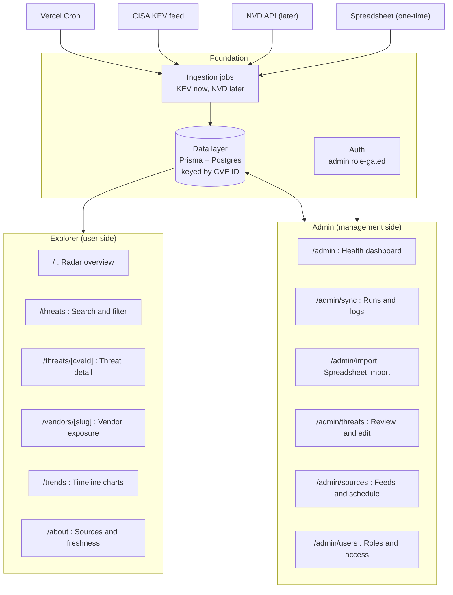

# Threat Radar blueprint

A live threat radar built from a cybersecurity spreadsheet. It pulls known exploited vulnerabilities from CISA KEV now, and adds CVSS scores from NVD later.

**Stack:** Next.js 16, TypeScript, Prisma, Postgres, deployed on Vercel.

## Architecture at a glance



## Foundation

Not a module. Both sides sit on it.

| Piece          | Purpose                                                                                                                                                                     |
| -------------- | --------------------------------------------------------------------------------------------------------------------------------------------------------------------------- |
| Data layer     | A normalized `Vulnerability` record keyed by CVE ID. KEV fields are required; CVSS and NVD fields are optional so enrichment can be added later without reshaping anything. |
| Ingestion jobs | Scheduled KEV sync now, NVD enrichment later, plus a one-time spreadsheet import. All idempotent (upsert by CVE ID).                                                        |
| Auth           | Public for the user side, role-protected for `/admin`.                                                                                                                      |

Suggested Prisma models: `Vulnerability`, `SyncRun`, `Source`, `ImportBatch`, `User`.

## Module 1: Explorer (user side)

User pages live directly under `app/`, with no route groups.

| Route                            | Purpose                                                                                                                      |
| -------------------------------- | ---------------------------------------------------------------------------------------------------------------------------- |
| `/`                              | Radar overview: newly added this week, total KEV count, top vendors, ransomware-linked count, upcoming remediation due dates |
| `/threats`                       | Searchable, filterable list (vendor, product, date added, due date, ransomware use, CVSS once available)                     |
| `/threats/[cveId]`               | Detail view: description, required action, dates, references, CVSS and vector (later)                                        |
| `/vendors` and `/vendors/[slug]` | Browse exposure by vendor or product                                                                                         |
| `/trends`                        | Timeline charts: additions over time, vendor breakdown, ransomware trends                                                    |
| `/about`                         | Data sources, freshness, and disclaimers                                                                                     |

Later, if you add accounts: `/watchlist` for saved filters and tracked products.

## Module 2: Admin (management side)

| Route            | Purpose                                                                                 |
| ---------------- | --------------------------------------------------------------------------------------- |
| `/admin`         | Health dashboard: last sync times, record counts, failed runs                           |
| `/admin/sync`    | Run history, manual trigger, error logs (KEV now, NVD later)                            |
| `/admin/import`  | One-time spreadsheet import with preview and validation                                 |
| `/admin/threats` | Review and edit records: internal notes, tags, priority overrides, hide or flag entries |
| `/admin/sources` | Feed URLs, NVD API key, sync schedule                                                   |
| `/admin/users`   | Roles and access                                                                        |

## Folder structure

```text
threat-radar/
├── app/
│   ├── layout.tsx
│   ├── page.tsx                    # /  radar overview (existing file)
│   ├── threats/
│   │   ├── page.tsx                # /threats
│   │   └── [cveId]/
│   │       └── page.tsx            # /threats/[cveId]
│   ├── vendors/
│   │   ├── page.tsx                # /vendors
│   │   └── [slug]/
│   │       └── page.tsx            # /vendors/[slug]
│   ├── trends/
│   │   └── page.tsx
│   ├── about/
│   │   └── page.tsx
│   ├── admin/
│   │   ├── layout.tsx              # admin shell + server-side auth check
│   │   ├── page.tsx                # /admin
│   │   ├── sync/
│   │   │   ├── page.tsx
│   │   │   └── actions.ts          # manual trigger (server action)
│   │   ├── import/
│   │   │   ├── page.tsx
│   │   │   └── actions.ts          # preview, validate, commit
│   │   ├── threats/
│   │   │   ├── page.tsx
│   │   │   └── actions.ts          # notes, tags, overrides, hide/flag
│   │   ├── sources/
│   │   │   ├── page.tsx
│   │   │   └── actions.ts
│   │   └── users/
│   │       ├── page.tsx
│   │       └── actions.ts
│   └── api/
│       ├── cron/
│       │   ├── kev/route.ts        # Vercel Cron target: KEV sync
│       │   └── nvd/route.ts        # Vercel Cron target: NVD enrichment (later)
│       └── auth/
│           └── [...auth]/route.ts  # auth handlers, depends on your auth library
├── components/
│   ├── ui/                         # buttons, tables, badges, inputs
│   ├── threats/                    # filters, threat table, detail panels
│   ├── charts/                     # trend and vendor charts
│   └── admin/                      # sync run table, import preview, etc.
├── lib/
│   ├── db.ts                       # Prisma client singleton
│   ├── auth.ts                     # session helpers, requireAdmin()
│   ├── ingest/
│   │   ├── kev.ts                  # fetch + parse CISA KEV
│   │   ├── nvd.ts                  # fetch + parse NVD (later)
│   │   ├── spreadsheet.ts          # parse + validate imported rows
│   │   ├── normalize.ts            # source data -> Vulnerability shape
│   │   └── run.ts                  # shared runner: logs a SyncRun, upserts, revalidates
│   ├── queries/
│   │   ├── threats.ts              # list, filter, detail
│   │   ├── vendors.ts
│   │   └── stats.ts                # overview + trends aggregates
│   └── validation/                 # shared schemas for filters, forms, imports
├── prisma/
│   ├── schema.prisma
│   └── migrations/
├── proxy.ts                        # Next.js 16 replacement for middleware.ts
├── vercel.json                     # cron schedules
├── .env.example                    # DATABASE_URL, CRON_SECRET, NVD_API_KEY, auth secrets
└── BLUEPRINT.md
```

## Conventions

- **Public pages are server components** that read through `lib/queries/*`. Pages never talk to Prisma directly.
- **Admin writes use server actions** colocated in each admin folder. Each action re-checks the admin role via `requireAdmin()`.
- **`proxy.ts` is only a first gate.** It redirects unauthenticated requests away from `/admin`. The real check lives in `app/admin/layout.tsx` and in every action.
- **Ingestion goes through `lib/ingest/run.ts`.** Cron routes and the manual trigger in `/admin/sync` call the same code, so run history is always logged the same way.
- **Revalidate after each sync** so the public pages show fresh data without a redeploy.
- **Dynamic route `params` are Promises** in current Next.js versions, so `await params` in `[cveId]` and `[slug]` pages.

## Vercel notes

- **Cron:** schedules go in `vercel.json` and call the `app/api/cron/*` routes with a GET request. Protect them by checking the `Authorization` header against `CRON_SECRET`.
- **Function duration:** keep ingestion batched and idempotent so a timeout mid-run can safely resume. This matters most for NVD, which is rate-limited.
- **Upload size:** function request bodies are capped at about 4.5 MB. If the spreadsheet is larger, parse it in the browser and send rows in chunks, or upload to Blob storage first.
- **Database connections:** use a pooled Postgres connection string in `DATABASE_URL`, and run `prisma generate` as part of the build.

## Build order

1. Prisma schema and KEV ingestion (`lib/ingest/kev.ts`, `run.ts`, `api/cron/kev`)
2. `/threats` and `/threats/[cveId]`
3. `/` overview and `/admin/sync`
4. Auth, `proxy.ts`, and the remaining admin pages
5. Spreadsheet import, then `/vendors` and `/trends`
6. NVD enrichment, which fills the optional CVSS fields and lights up the CVSS filters
